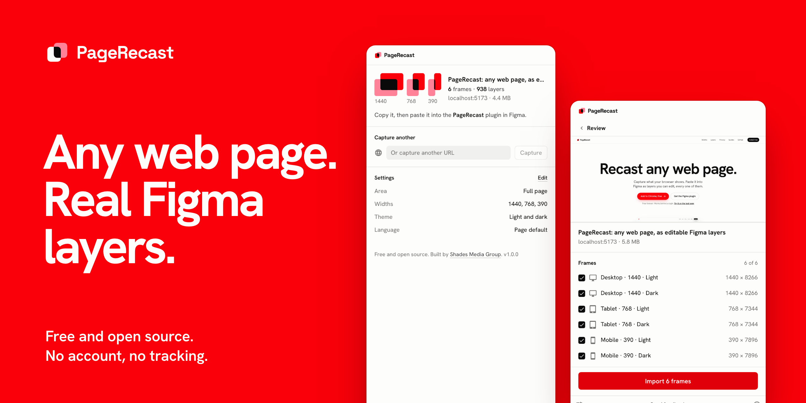

<a id="top"></a>

<p align="center">
  <picture>
    <source media="(prefers-color-scheme: dark)" srcset="assets/brand/readme-banner-dark.png">
    
  </picture>
</p>

<h3 align="center">Turn any web page into editable Figma layers.<br>Free, open source, and nothing leaves your computer.</h3>

<p align="center">
  <a href="https://github.com/Shades-Media-Group/PageRecast/actions/workflows/ci.yml"></a>
  <a href="https://github.com/Shades-Media-Group/PageRecast/releases/latest"></a>
  <a href="LICENSE"></a>
</p>

<p align="center">
  <a href="https://pagerecast.shades.md"><b>Website</b></a> ·
  <a href="docs/guides/README.md"><b>Guides</b></a> ·
  <a href="https://pagerecast.shades.md/sample/"><b>Test page</b></a> ·
  <a href="CHANGELOG.md"><b>Changelog</b></a>
</p>

<p align="center">
  <a href="https://chromewebstore.google.com/detail/iidlcnlnejbmdihmbfiojpikhgaggkel"><b>Add to Chrome</b></a> ·
  <a href="https://www.figma.com/community/plugin/1690893819753299295"><b>Get the Figma plugin</b></a> ·
  <a href="https://github.com/Shades-Media-Group/PageRecast/releases/latest"><b>Latest release</b></a>
</p>

## What it does

- **Captures what your browser shows:** the full page, the visible area or one element, including pages behind a login, staging and `localhost`.
- **Every layout in one go:** several widths from 240 to 3840 px, in light, dark or both, and in another language.
- **Real Figma layers, not a picture:** frames, text with its fonts and styles, images, SVG vectors and Auto Layout where it matches the page.
- **Fits your file:** colour variables with Light and Dark modes, text styles, or the styles already in your file.
- **Free with no catch:** no account, no plan, no limits, no server.

## How it works

1. **Capture in Chrome.** Open the page, click PageRecast, pick the widths and themes, and press Capture.
2. **Paste in Figma.** Press **Copy for Figma**, run the PageRecast plugin and paste with `⌘ V` / `Ctrl V`.
3. **Import and edit.** Check the frames, press Import, and keep working on real layers.

Want something to try first? The [test page](https://pagerecast.shades.md/sample/) is built to exercise every feature: type, colour, layout, surfaces, vectors, images and controls. [Getting started](docs/guides/getting-started.md) walks through it in about two minutes.

## Features

| Capture                                                            | Import into Figma                                                                |
| ------------------------------------------------------------------ | -------------------------------------------------------------------------------- |
| Full page, visible area or one picked element                      | Frames with fills, gradients, borders, per-corner radii, shadows, blur, rotation |
| Desktop, laptop, tablet, mobile or any width from 240 to 3840 px   | Text with every inline style kept, fonts matched through each CSS font stack     |
| Light, dark or both, and the page in another language              | Images, SVG as editable vectors, snapshots of canvas, video and embeds           |
| Pages behind a login, staging and `localhost`, or any URL unopened | Auto Layout wherever it reproduces the page exactly                              |
| Cookie banners hidden, lazy content loaded, animations settled     | Colour variables with Light and Dark modes, text styles, or your existing styles |
| Copy for Figma, or save a [`.recast`](docs/scene-format.md) file   | A locked screenshot beside each frame to compare against                         |

The plugin also imports `.html` files and pasted HTML and CSS without the extension, and remembers import options per site.

## Privacy

PageRecast has no server. The extension builds the capture in your browser and the plugin builds layers in Figma, so nothing about the page leaves your computer. The only network requests are the plugin downloading images the page already references, straight from the sites they belong to. There are no accounts, analytics or crash reports. Read the [privacy policy](https://pagerecast.shades.md/privacy/).

## Install

| Part             | Install from                                                                                  |
| ---------------- | --------------------------------------------------------------------------------------------- |
| Chrome extension | [Chrome Web Store](https://chromewebstore.google.com/detail/iidlcnlnejbmdihmbfiojpikhgaggkel) |
| Figma plugin     | [Figma Community](https://www.figma.com/community/plugin/1690893819753299295)                 |

Both listings are in review for their first release. Until they go live, or to run a specific version, install from the [latest release](https://github.com/Shades-Media-Group/PageRecast/releases/latest):

1. **Chrome:** unzip `pagerecast-chrome-extension-*.zip`, open `chrome://extensions`, turn on **Developer mode**, choose **Load unpacked** and pick the folder. Works in Chrome, Edge, Brave, Arc and other Chromium browsers.
2. **Figma:** unzip `pagerecast-figma-plugin-*.zip`, then in Figma desktop choose **Plugins → Development → Import plugin from manifest** and pick `manifest.json`.

### Build from source

Requires Node 22 (see `.nvmrc`) and Yarn 1.

```bash
git clone https://github.com/Shades-Media-Group/PageRecast.git
cd PageRecast
yarn install
yarn build        # apps/extension/dist and apps/figma-plugin/dist
yarn verify       # typecheck, lint, unit tests and build
yarn test:e2e     # Playwright against real pages and the built extension
```

Load `apps/extension/dist` as an unpacked extension and import `apps/figma-plugin/manifest.json` in Figma. The [architecture notes](docs/architecture.md) explain how the pieces fit, and captures use an open, documented format: [`.recast`](docs/scene-format.md).

## Guides

[Getting started](docs/guides/getting-started.md) ·
[Private pages and localhost](docs/guides/private-pages.md) ·
[Widths, themes and languages](docs/guides/widths-themes-language.md) ·
[Import options](docs/guides/import-options.md) ·
[Fonts](docs/guides/fonts.md) ·
[HTML files and code](docs/guides/html-and-code.md) ·
[Troubleshooting](docs/guides/troubleshooting.md)

## Contributing and support

- **A page imported badly?** Open an [import report](https://github.com/Shades-Media-Group/PageRecast/issues/new?template=import.yml) with the URL and a screenshot. These are the most useful reports.
- **Questions and ideas:** [Discussions](https://github.com/Shades-Media-Group/PageRecast/discussions) and [SUPPORT.md](SUPPORT.md).
- **Pull requests:** read [CONTRIBUTING.md](CONTRIBUTING.md) and the [Code of Conduct](CODE_OF_CONDUCT.md).
- **Security issues:** report them privately as described in [SECURITY.md](SECURITY.md).

## License

[MIT](LICENSE) © Shades Media Group

---

<p align="center">
  Built by <a href="https://github.com/CristianBrinza">Cristian Brinza</a> | <a href="https://shades.md">Shades Media Group</a>
  <br>
  <sub><a href="#top">Back to top</a></sub>
</p>
